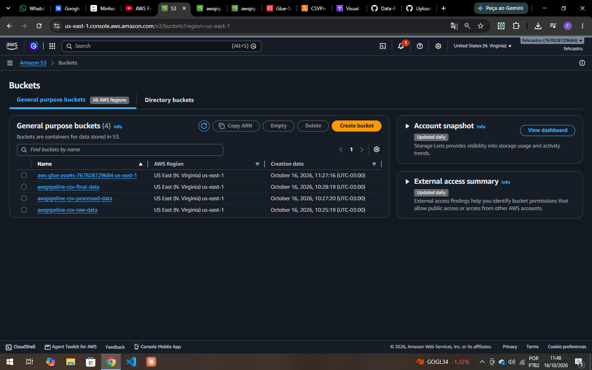
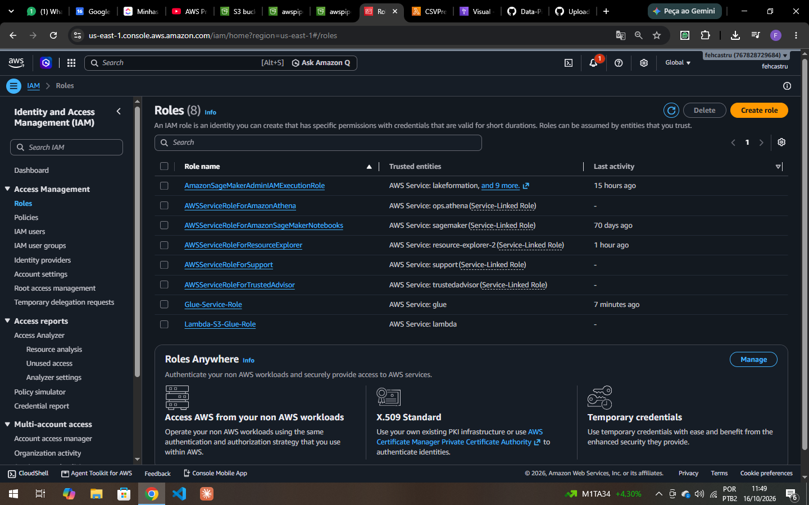
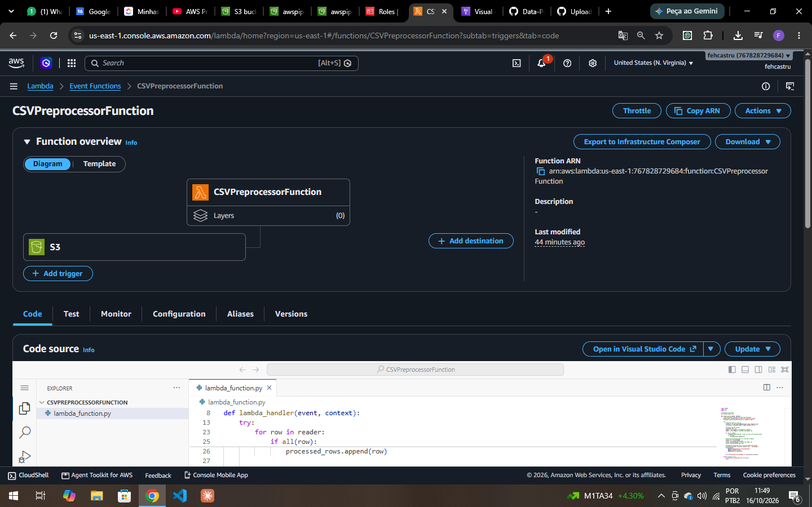
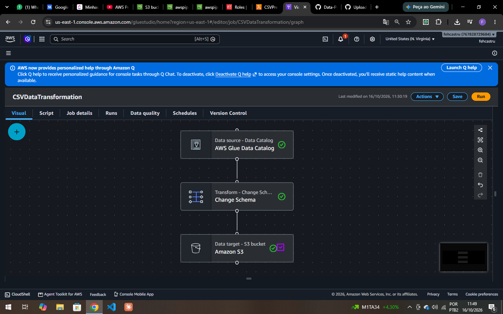

# Data Pipeline AWS — CSV com S3, Lambda, Glue e QuickSight

Pipeline de dados **serverless e orientado a eventos** na AWS para ingestão, limpeza, transformação e visualização de arquivos CSV. Ao enviar um CSV para o bucket de entrada, uma função Lambda é disparada automaticamente para pré-processar o arquivo; em seguida, um job do AWS Glue aplica as transformações de schema e grava os dados finais, que alimentam dashboards no Amazon QuickSight.

O dataset de exemplo (`weather_data.csv`) contém dados meteorológicos horários (temperatura, umidade, vento, radiação solar, nuvens, etc.).

---

## Arquitetura

```
             upload .csv
                 │
                 ▼
┌──────────────────────────────┐   S3 Event    ┌─────────────────────────────────┐
│ S3: awspipeline-csv-raw-data │ ────────────▶ │ Lambda: CSVPreprocessorFunction │
└──────────────────────────────┘               └────────────────┬────────────────┘
                                                                │ remove linhas com valores ausentes
                                                            ┌───┘
                                                            ▼
                                         ┌────────────────────────────────────┐
                                         │ S3: awspipeline-csv-processed-data │
                                         └──────────────────┬─────────────────┘
                                                            │ Data Catalog
                                                            ▼
                                         ┌────────────────────────────────────┐
                                         │ Glue Job: CSVDataTransformation    │
                                         │ (Data Catalog → Change Schema → S3)│
                                         └──────────────────┬─────────────────┘
                                                            ▼
                                         ┌────────────────────────────────────┐
                                         │ S3: awspipeline-csv-final-data     │
                                         └──────────────────┬─────────────────┘
                                                            │ manifest.json
                                                            ▼
                                         ┌────────────────────────────────────┐
                                         │ Amazon QuickSight (dashboards)     │
                                         └────────────────────────────────────┘
```

---

## Serviços Utilizados

- **Amazon S3:** armazenamento escalável dos dados brutos, processados e finais, com notificações de eventos do S3 que habilitam a arquitetura orientada a eventos. `[Storage]`
- **AWS Lambda:** camada de computação serverless, disparada automaticamente para pré-processar e limpar os arquivos CSV assim que são enviados ao S3. `[Compute]`
- **AWS Glue:** recursos de ETL para extrair, transformar e carregar os dados em um formato pronto para análise. `[ETL/Big Data]`
- **Amazon QuickSight:** dashboards e relatórios interativos para visualização dos dados. `[Analytics]`
- **IAM Roles e Policies:** garantem acesso seguro entre S3, Lambda, Glue e QuickSight. `[Permissions]`

---

## Passo a Passo

### 1. Criar os buckets no Amazon S3

Foram criados três buckets na região `us-east-1`, um para cada camada do pipeline:

| Bucket | Finalidade |
|---|---|
| `awspipeline-csv-raw-data` | Recebe os arquivos CSV brutos (gatilho da Lambda) |
| `awspipeline-csv-processed-data` | Armazena os CSVs limpos pela Lambda |
| `awspipeline-csv-final-data` | Armazena a saída transformada pelo Glue (fonte do QuickSight) |

O bucket `aws-glue-assets-*` é criado automaticamente pelo Glue para scripts e arquivos temporários do job.



### 2. Configurar as IAM Roles

Duas roles dão aos serviços apenas as permissões necessárias:

- **`Lambda-S3-Glue-Role`** — assumida pela Lambda; permite ler do bucket raw, gravar no bucket processed e registrar logs no CloudWatch.
- **`Glue-Service-Role`** — assumida pelo Glue; permite ler o Data Catalog e os buckets de origem e gravar no bucket final.



### 3. Criar a função Lambda de pré-processamento

A função **`CSVPreprocessorFunction`** (Python) tem como trigger um evento de criação de objeto no bucket raw. Ela:

1. Lê o CSV enviado ao S3 a partir do evento;
2. Mantém o cabeçalho e **descarta linhas com valores ausentes**;
3. Grava o resultado no bucket de dados processados, trocando o prefixo `raw/` por `processed/`.

```python
for row in reader:
    # filtra linhas com valores ausentes
    if all(row):
        processed_rows.append(row)

processed_file_key = file_key.replace('raw/', 'processed/')
s3.put_object(Bucket='<YOUR_PROCESSED_BUCKET_NAME>', Key=processed_file_key, Body=output_csv.getvalue())
```

Código completo em [`lambda/lambda_function.py`](lambda/lambda_function.py).



### 4. Criar o job de ETL no AWS Glue

O job **`CSVDataTransformation`**, criado no Glue Studio (editor visual), é composto por três nós:

1. **Data source — AWS Glue Data Catalog:** lê a tabela catalogada a partir dos dados processados;
2. **Transform — Change Schema:** ajusta nomes e tipos das colunas, removendo as que não são necessárias para a análise;
3. **Data target — Amazon S3:** grava o resultado no bucket `awspipeline-csv-final-data`.



### 5. Visualizar no Amazon QuickSight

O QuickSight se conecta ao bucket final através do arquivo [`manifest.json`](manifest.json), que indica a localização dos dados e as configurações de leitura do CSV:

```json
{
  "fileLocations": [
    { "URIs": ["<YOUR_URI>"] }
  ],
  "globalUploadSettings": { "textqualifier": "\"" }
}
```

Substitua `<YOUR_URI>` pelo caminho do arquivo no S3 (ex.: `s3://awspipeline-csv-final-data/...`), crie um dataset do tipo **S3** no QuickSight usando o manifest e monte os dashboards.

---

## Estrutura do Repositório

```
data_pipeline_aws/
├── aws-steps/              # Prints de cada etapa no console da AWS
│   ├── s3-buckets.png
│   ├── roles.png
│   ├── lambda-functions.png
│   └── aws-glue.png
├── lambda/
│   └── lambda_function.py  # Função de pré-processamento do CSV
├── manifest.json           # Manifest de conexão S3 → QuickSight
├── weather_data.csv        # Dataset de exemplo
└── README.md
```

---

## Como Reproduzir

1. Crie os três buckets S3 (raw, processed e final);
2. Crie as roles `Lambda-S3-Glue-Role` e `Glue-Service-Role` com as permissões descritas acima;
3. Crie a Lambda com o código de `lambda/lambda_function.py`, substitua `<YOUR_PROCESSED_BUCKET_NAME>` e adicione o trigger de evento S3 no bucket raw;
4. Catalogue os dados processados no Glue Data Catalog e crie o job `CSVDataTransformation` (Data Catalog → Change Schema → S3);
5. Envie o `weather_data.csv` para o bucket raw e execute o job do Glue;
6. Ajuste o `manifest.json` com a URI do bucket final e crie o dataset no QuickSight.

---

## Stack

`AWS S3` · `AWS Lambda` · `AWS Glue` · `Amazon QuickSight` · `AWS IAM` · `Python` · `boto3`
